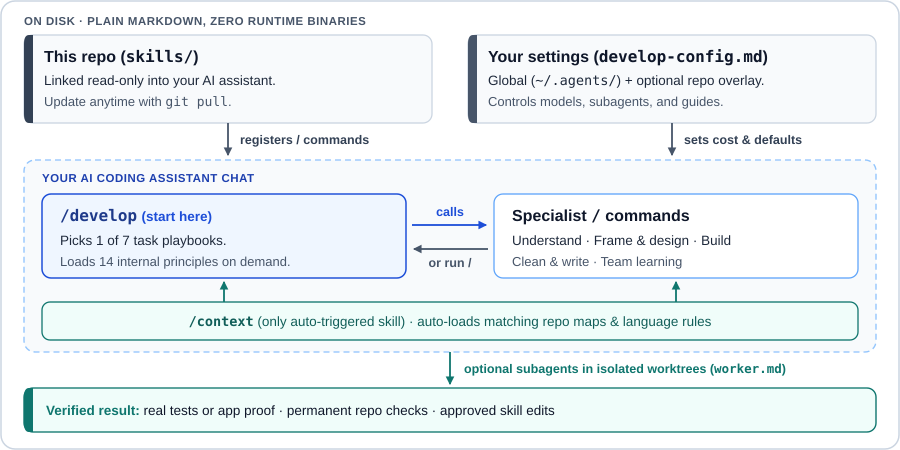

# uw-loci/agent-skills

A shared folder of plain Markdown workflows ("skills") that add `/` commands to **Antigravity**, **VS Code / GitHub Copilot**, **Claude Code**, **Cursor**, and other [Agent Skills](https://agentskills.io)-compatible coding assistants. Derived from [`cursor/plugins/pstack`](https://github.com/cursor/plugins/tree/main/pstack) (via [`backnotprop/pstack`](https://github.com/backnotprop/pstack)), this repository ships **20 skills** centered on `/develop`, **7 playbooks**, **14 engineering principles**, and **5 UW-LOCI context guides**.

[](docs/overview.md)

Read [How it works](docs/overview.md) for the conceptual map and disk layout, [Quick reference](docs/quick-reference.md) for all 20 `/` commands, or download the double-sided [2-page printable handout (PDF)](docs/handouts/agent-skills-handout.pdf).

## New to Agent Skills? (FAQ)

- **What is a skill?** A skill is a folder containing a Markdown file (`SKILL.md`) with a short YAML header (`name` and `description`) followed by instructions for your AI coding assistant. Installing this repository registers those folders so typing `/` in chat runs a repeatable workflow instead of retyping long prompts.
- **How does this repository interact with my assistant?** There is no runtime binary or background service. Installation links this local git clone into your assistant's skill directory, and your personal preferences live outside the repo in `~/.agents/develop-config.md`. Nineteen of the 20 skills run only when you type `/<command>`. Only `/context` activates automatically when you open a matching UW-LOCI repository.
- **Where should I start on day one?** Start with `/develop` (state your goal and how to verify it worked, or run `/develop` alone and answer its questions) and `/how` (to explore unfamiliar code). Ignore the other 18 commands until you need them.
- **Where can I read more about customizing my assistant?** See the open standard at [agentskills.io](https://agentskills.io) and official guides for [VS Code / GitHub Copilot](https://code.visualstudio.com/docs/agent-customization/agent-skills), [Claude Code](https://code.claude.com/docs/en/skills), and [Cursor](https://cursor.com/docs/skills) (plus Antigravity paths in [docs/harness.md](docs/harness.md)).

## Quick start (agent-assisted installation)

1. Clone this repository to a stable location on your machine:
   ```bash
   # HTTPS (works everywhere, no SSH key needed)
   git clone https://github.com/uw-loci/agent-skills.git

   # Or SSH
   git clone git@github.com:uw-loci/agent-skills.git
   ```
2. Open the cloned repository in your coding assistant and ask:
   ```text
   Read AGENTS.md and install these skills for me.
   ```
3. Answer the setup prompts (coding assistant, global versus per-repo scope, live link versus copy, subagent delegation policy, parallel subagent count, effort-tier models, and automatic context guides).
4. Let the assistant write `~/.agents/develop-config.md`, link all 20 skills without modifying `skills/`, and run [docs/validation.md](docs/validation.md).
5. Open a **new chat session** (or reload your IDE window) so your assistant loads the linked skills.

> **Updating, tuning, or uninstalling:** Run `git pull` inside your clone, then re-run [docs/validation.md](docs/validation.md). Edit `~/.agents/develop-config.md` (or run `/context configure`) at any time to adjust models, subagent spend, or repo guides. See the **Uninstalling** section in [AGENTS.md](AGENTS.md) for clean removal.

## Start with these commands

Give `/develop` your goal and a check that proves it worked (or run `/develop` alone and let it ask):

```text
/develop Fix the crash when the input CSV has empty rows.
Done check: pytest passes with a new empty-row regression test.
Constraint: preserve existing CLI flags.
```

Five commands cover most daily work:

| Command | Use when |
|---|---|
| `/develop` | Bugs, features, refactors, plans, prototypes, or PRs (routes 7 playbooks and 14 principles) |
| `/how` | Trace how a subsystem works or where new code belongs |
| `/tdd` | Write a failing test first, confirm it fails, then implement the fix |
| `/interrogate` | Adversarial review of your diff or design where only run-proven findings survive |
| `/context` | Auto-loads matching UW-LOCI repo maps (`fiji-imagej`, `tme-quant`, `qupath`) and `java` or `python` guides; run `/context configure` to change defaults |

See **[docs/quick-reference.md](docs/quick-reference.md)** for all 20 commands, defaults, and configuration settings.

## Documentation

- **[docs/overview.md](docs/overview.md):** First-5-minutes walkthrough, disk layout, host-enforced versus prompt behavior, and escape hatches.
- **[docs/quick-reference.md](docs/quick-reference.md):** Complete reference for all 20 `/` commands and `develop-config.md` settings.
- **[docs/handouts/agent-skills-handout.pdf](docs/handouts/agent-skills-handout.pdf):** Double-sided printable 2-page handout (regenerated from source docs and [architecture-overview.svg](docs/assets/architecture-overview.svg) via [scripts/build-handouts.py](scripts/build-handouts.py)).
- **[AGENTS.md](AGENTS.md):** Agent-facing installation, uninstallation, and repository maintenance instructions.
- **[docs/harness.md](docs/harness.md):** Skill discovery paths, Windows notes, and optional custom agent wrappers across coding assistants.
- **[skills/develop/references/config-and-subagents.md](skills/develop/references/config-and-subagents.md):** Single runtime reference for config merging, effort tiers, supported model values, tool mappings, and fallbacks.
- **[docs/validation.md](docs/validation.md):** Three-suite read-only validation checklist for repo integrity, links, config, and live subagents.
- **[CHANGELOG.md](CHANGELOG.md):** Release history and upstream components intentionally omitted.

## License

MIT (see [LICENSE](LICENSE)). Derived from `cursor/plugins/pstack` by Lauren Tan (Poteto) and `backnotprop/pstack`.
