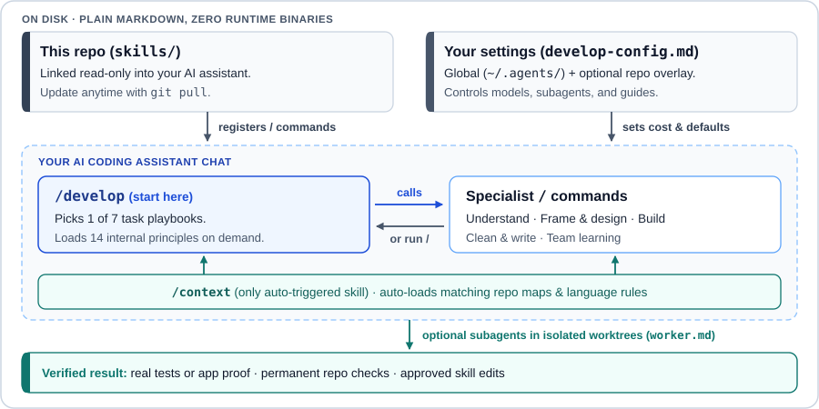

# How uw-loci/agent-skills works

This repository is a folder of plain Markdown checklists ("skills") that add `/` commands to your AI coding assistant. There is no runtime binary or background service. For the full command list, see [Quick reference](quick-reference.md). For the double-sided printable version, open [agent-skills-handout.pdf](handouts/agent-skills-handout.pdf).



## First 5 minutes

1. **Install.** Clone this repository, open it in your coding assistant, and ask *"Read AGENTS.md and install these skills for me."* Start a new chat session so the assistant loads the new commands.
2. **Run `/develop`.** Give your goal and a check that proves it worked, or run `/develop` alone and answer its brief questions:
   ```text
   /develop Fix the crash when the input CSV has empty rows.
   Done check: pytest passes with a new empty-row regression test.
   ```
3. **Update or tune later.** Run `git pull` inside your clone to pick up updates cleanly. Edit `~/.agents/develop-config.md` (or run `/context configure`) to change models, delegation, or active repo guides without touching `skills/`.

## Under the hood

### What your assistant enforces versus prompt conventions

Your coding assistant parses only two things from this repository:

1. **Registration** (`skills.json`, symlinks, or Windows directory junctions) so it discovers the skill folders.
2. **YAML frontmatter** at the top of each `SKILL.md` (`name`, `description`, and `disable-model-invocation: true` on 19 skills so only `/context` auto-triggers).

Everything else (playbook selection, principle loading, `develop-config.md` overlays, `worker.md` subagent handoffs, and sibling command calls) is plain Markdown read by the model. Nothing is compiled or hidden.

### Where things live on disk

- `skills/<name>/SKILL.md` holds all 20 slash commands.
- `skills/develop/playbooks/` holds the 7 task playbooks (investigation, bug fix, feature, refactoring, prototype, multi-phase plan, and opening a PR).
- `skills/develop/references/principles/` holds the 14 engineering principles (read on demand by `/develop`, kept out of `/` menus).
- `skills/develop/worker.md` and `skills/develop/references/config-and-subagents.md` define subagent kickoff rules, tool mappings, and config lookup across assistants (no separate `agents/` folder is shipped).
- `skills/context/references/` holds UW-LOCI ecosystem maps (`fiji-imagej`, `tme-quant`, `qupath`) and language guides (`java`, `python`).
- `~/.agents/develop-config.md` stores your local settings; an optional `<repo>/.agents/develop-config.md` overrides individual keys per repository.

### Escape hatches

- **Skip the setup interview.** Write a minimal `~/.agents/develop-config.md` from [config-and-subagents.md](../skills/develop/references/config-and-subagents.md) and link `<clone>/skills` using [harness.md](harness.md).
- **Stop helper subagent spend.** Set `delegation_policy: single-agent` in `develop-config.md`.
- **Disable automatic context loading.** Set `default_contexts: none` in `develop-config.md`.
- **Skip `/develop`.** Run any specialist `/` command directly, or read its `SKILL.md` yourself.

## Related guides

- [Quick reference](quick-reference.md) lists all 20 installed `/` commands and settings.
- [Cross-assistant discovery reference](harness.md) documents install paths, Windows notes, and optional custom agent wrappers.
- [Validation checklist](validation.md) verifies repository integrity, installed links, and subagent wiring.
